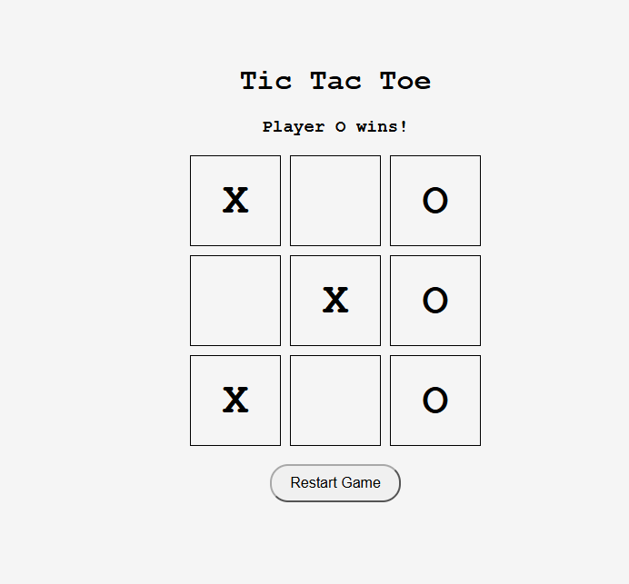

# Tic Tac Toe

A browser-based, two-player Tic Tac Toe game built with HTML, CSS, and JavaScript. The game uses object-oriented programming to manage player turns, track moves, detect winning combinations, and handle game resets.

## Live Demo

**[Play Tic Tac Toe](https://anwaralshohatee.github.io/tic-tac-toe-game/)**

## Technologies


## Features

- Two-player gameplay with alternating X and O turns
- Interactive 3×3 game board
- Automatic detection of winning combinations
- Draw detection when the board is full
- Prevention of moves on occupied cells
- Game status updates showing the current player or winner
- Restart button to begin a new game
- Object-oriented game logic using a JavaScript class

## Screenshot



## Getting Started

### 1. Clone the Repository

```bash
git clone https://github.com/AnwarAlshohatee/tic-tac-toe-game.git
cd tic-tac-toe-game
```

### 2. Run the Application

Open `index.html` in your browser.

No additional dependencies or installations are required.

## How to Play

1. Player X starts the game.
2. Players take turns selecting an empty square.
3. The first player to connect three matching symbols horizontally, vertically, or diagonally wins.
4. If all nine squares are filled without a winner, the game ends in a draw.
5. Click **Restart Game** to play again.

## Future Improvements

- Add a single-player mode with a computer opponent
- Track wins, losses, and draws across rounds
- Highlight the winning combination
- Improve the layout for smaller screens

## Author

**Anwar Alshohatee**

[Portfolio](https://anwaralshohatee.netlify.app) | [LinkedIn](https://www.linkedin.com/in/anwaralshohatee/)
